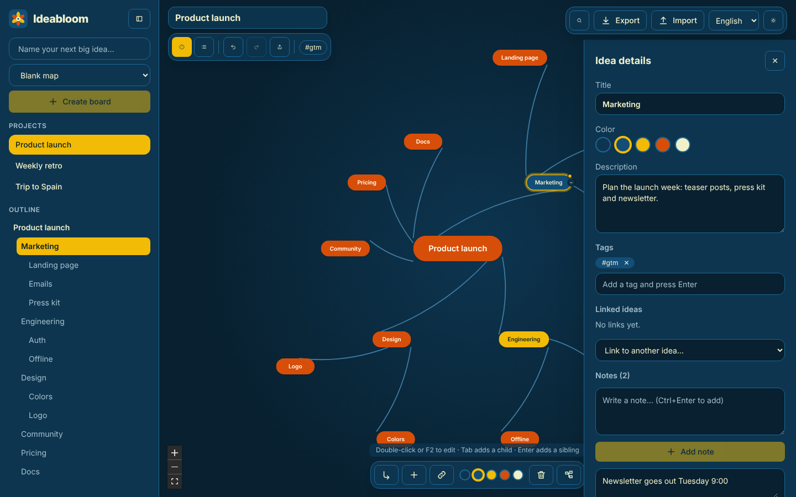
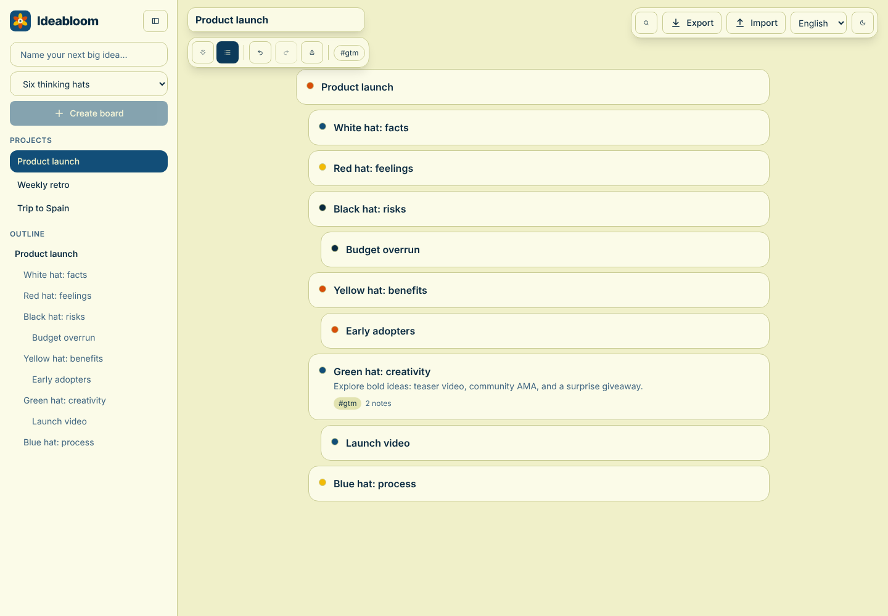
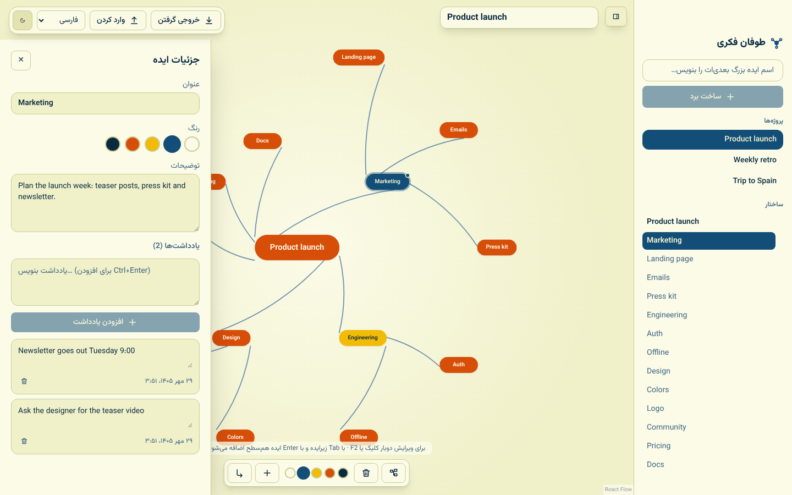

# Ideabloom


A local-first mind-map brainstorming app. Your boards never leave your browser:
they are stored in IndexedDB, with JSON export/import for backups.





## Features

- Search everything with `Ctrl+K`; undo/redo (`Ctrl+Z` / `Ctrl+Shift+Z`) per project
- Collapse branches, free links between ideas, tags with filtering, and a list view
- Templates (SWOT, Six Hats, Pros/Cons, 5W1H, Project plan)
- Export as PNG, SVG or Markdown; installable offline PWA

- Multiple projects in a collapsible side panel (project list + outline of the open map)
- Radial mind map: add children (`Tab`) and siblings (`Enter`), edit (`F2` / double-click), delete (`Del`), recolor, drag, tidy layout
- Click an idea to open its details: a description plus any number of separate notes
- English, Spanish and Persian (with RTL), light and dark themes
- Works offline once loaded; JSON backup and restore

## Stack

Vite · React · TypeScript · Tailwind CSS v4 · @xyflow/react · Dexie (IndexedDB) · Zustand · i18next · Zod

Architecture: [Feature-Sliced Design](https://feature-sliced.design) (`app → pages → widgets → features → entities → shared`).
Palette: `#0a1128 #001f54 #034078 #1282a2 #fefcfb`.

## Scripts

```bash
pnpm install
pnpm dev          # dev server
pnpm build        # type-check + production build
pnpm lint         # ESLint (includes FSD import rules)
pnpm format       # Prettier
pnpm test         # Jest unit/integration tests
pnpm e2e          # Playwright end-to-end tests
```

## Deploying and security

See [SECURITY.md](SECURITY.md) and `deploy/nginx/`. CI (`.github/workflows`) runs audit, lint, typecheck, tests and e2e, then deploys the static build.
