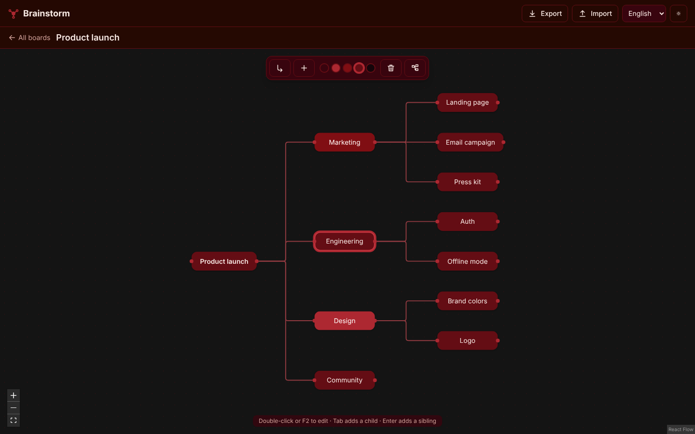
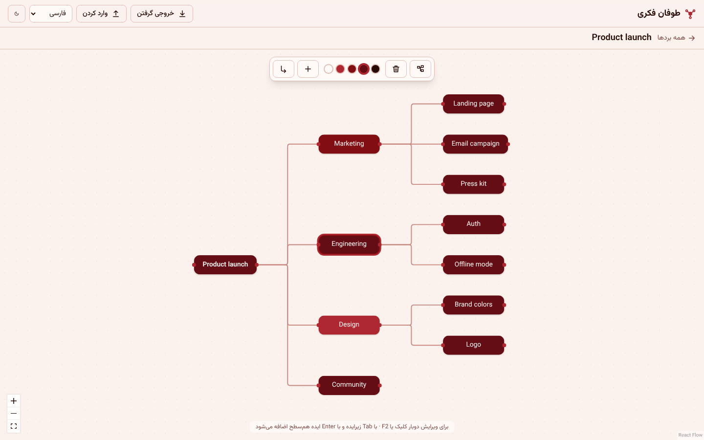

# Brainstorm

A local-first mind-map brainstorming app. Your boards never leave your browser:
they are stored in IndexedDB, with JSON export/import for backups.




## Features

- Multiple boards, each a mind map: add children (`Tab`) and siblings (`Enter`), edit (`F2` / double-click), delete (`Del`), recolor, drag, tidy layout
- English, Spanish and Persian (with RTL), light and dark themes
- Works offline once loaded; JSON backup and restore

## Stack

Vite · React · TypeScript · Tailwind CSS v4 · @xyflow/react · Dexie (IndexedDB) · Zustand · i18next · Zod

Architecture: [Feature-Sliced Design](https://feature-sliced.design) (`app → pages → widgets → features → entities → shared`).
Palette: `#250902 #38040e #640d14 #800e13 #ad2831`.

## Scripts

```bash
pnpm install
pnpm dev          # dev server
pnpm build        # type-check + production build
pnpm lint         # ESLint (includes FSD import rules)
pnpm format       # Prettier
pnpm test         # Jest unit/integration tests
pnpm e2e          # Playwright end-to-end tests
```
